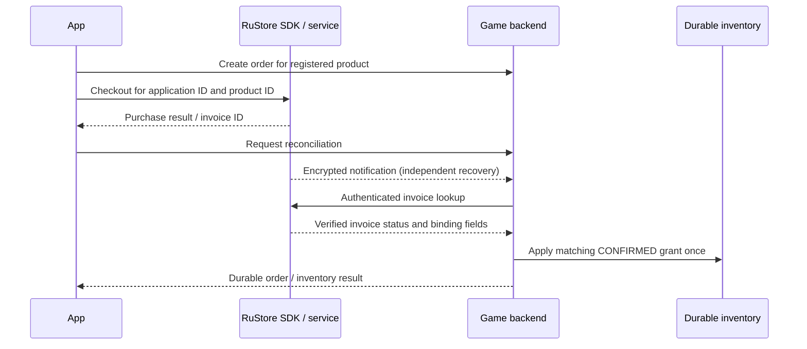

# Why these inputs are needed

The owner later selected **SDK checkout125**. Its simplified requirements are
[here](../RuStore/sdk-checkout125/README.md); it requires no RuStore API signing
credentials or notification key. This page explains the original `provider_api`
design and the separate optional VK/public-page materials.

These inputs connect the game to the owner's actual provider registrations,
allow the backend to verify and recover payments, and give players public
information and a support route. They do not all block development: backend
tests and monitoring can run without provider credentials, and VK is optional
for managed guest accounts.

| Input | Where it is used | Purpose | Confidential? |
| --- | --- | --- | --- |
| RuStore numeric application ID | SDK initialization, packaged checkout metadata, server catalogue and invoice binding | Selects the registered application that owns the twelve products. Product IDs alone do not identify the application. | Public configuration |
| VK numeric application ID | Backend-owned VK OAuth/PKCE registration and exact HTTPS callback | Identifies the app requesting VK consent and binds its allowed callback. It is not a VK user's ID. | Public configuration |
| Privacy, support and terms URLs | App/store metadata and the configured advertising/release profile | Gives players the actual operator/data practices, a usable help contact, and the applicable usage/purchase conditions. | Public webpages |
| RuStore API key ID plus private signing key | Restricted backend authentication to RuStore's payment APIs | Lets the backend obtain short-lived API authorization and independently query invoices for this owner's app. | Key ID is configuration; private key and authorization tokens are secrets |
| RuStore notification decryption key | Restricted backend notification receiver | Authenticates/decrypts the encrypted notification payload so the server can queue payment reconciliation after delayed or lost client responses. | Secret |

## The RuStore application ID

The server freezes the application ID, internal offer, registered product ID,
price, currency, player and order binding before checkout. A reported invoice
must match those terms before delivery. For Wellkeeper the registered product is
`hotr_bundle_wellkeeper_c`, priced at 99 RUB, with the approved full inventory
grant and once-per-player eligibility. The numeric application ID establishes
which Console application owns that product.

The application ID differs from the Android package, the twelve product IDs,
the API key ID and the release certificate. They perform different binding jobs.
[RuStore's application-ID instructions](https://www.rustore.ru/help/sdk/pay/unity/history/10-2-0).

## VK registration

VK uses its app ID and registered redirect to identify this login integration.
The backend's callback is
`https://api.novamind-it.ru/v1/identity/vk/callback`. The implemented flow uses
server-owned state/PKCE and device-signed completion. Linking a new VK identity
keeps the managed guest's existing player and wallet; restoring an existing
VK-linked player requires explicit confirmation. It does not silently merge
local saves or grant a reward.

VK can remain disabled while guest accounts and recovery-code workflows are
tested. Its ID is needed when enabling the requested VK feature, rather than
for the basic payment catalogue or monitor.
[Official VK ID SDK guide](https://github.com/VKCOM/vkid-web-sdk).

## The three public pages

The privacy page needs the actual operator, data/provider practices and contact
information. Support needs a real, monitored contact for account and purchase
problems. Terms need the final operator and applicable usage/purchase conditions.
These are the operator's pages; neither a domain nor a store product registration
creates their content automatically.

The owner requested temporary `/privacy`, `/support` and `/terms` pages on the
existing API domain. All three are now published, and their text clearly says
it is a draft and that operator/contact details are pending. Their exact HTTPS
bodies were verified from the VPS; independent external-browser acceptance
remains open. Temporary review URLs cannot establish
approved final content, a working support desk or release acceptance. No company
name, email, legal status or retention period has been invented.

## Server API authentication

The backend signs RuStore authentication requests with the Console-issued
private API key and its separate key ID, then obtains temporary API authorization.
That lets it query payment evidence without trusting an app success callback.
Keep the private key only on the server; the APK needs the public application
and product identifiers, not this key.

This is separate from the Android release keystore. The release keystore signs
the APK and establishes its update identity; the RuStore API key authenticates
server API requests. [Official API key setup](https://www.rustore.ru/help/work-with-rustore-api/api-authorization-process).

## Notification decryption and interrupted purchases

RuStore encrypts payment-notification payloads. Its separate notification key
allows this backend to authenticate/decrypt a payload and identify the invoice
that needs reconciliation. A closed app or interrupted network connection can
miss the normal client result, so notifications and the supervised retry worker
provide an independent recovery route.

If both the client invoice result and every notification are lost, the separate
bounded invoice-discovery command uses the API key and application ID to list
provider invoices and queue matching hints. It does not grant inventory. In the
current operations design, pause the reconciliation supervisor for this command
to release its exclusive operations lease, then resume reconciliation.

A notification only queues a provider lookup. The backend still verifies the
matching invoice and requires `CONFIRMED` before atomically granting inventory
once. Repeated notifications, reconnects and retries cannot create a second
grant. Trusted sender filtering, encryption and server-side invoice verification
serve separate purposes. [Official notification setup](https://www.rustore.ru/help/developers/monetization/payment-callback/enable-notifications).

For setup, provide the public app IDs and the private files' server locations.
Keep private key contents, temporary API tokens, signing passwords and player
recovery credentials out of chat, source, APK resources, public pages and logs.
